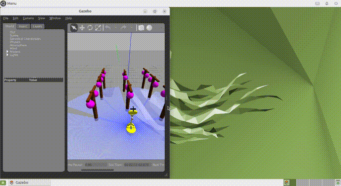

# 果樹園でのぶどう摘粒を目指した自律移動ロボットの制御実験
### Physical AI 応用編1 最終課題成果物



* **提出者アカウント (Omnicampus ID):** `apple123`
* **実演動画 (YouTube):** [PAI最終課題_apple123 (1分07秒 / 限定公開)](https://youtu.be/ZBLrnLefKKM)
* **提出説明資料 (PDF):** [説明資料_PAI最終課題_apple123.pdf](説明資料_PAI最終課題_apple123.pdf)

---

## 1. 課題の概要と目的

### 1.1 背景と将来の夢
日本の農業現場では高齢化と人手不足が進んでおり、特に果樹栽培における作業の自動化が強く求められています。その中でも「ぶどう栽培」における摘粒（てきりゅう: 密集した実を手作業で間引く作業）は、棚の下で上を向いたまま一房ずつ行うため、首や腕に負担がかかる大変な重労働です。  
私には「将来、この過酷なぶどうの摘粒作業を自動で行うロボットを作りたい」という夢があります。

### 1.2 本課題の目的
プログラミングやロボット制御の初心者である私にとって、いきなりアームで実を間引くロボットを作るのは難しいため、まずは本講座で学んだROS 2やGazeboシミュレータを活用し、ロボットの基礎となる「ぶどう棚の真下に潜り込んで安全に停止し、支柱を避けて次のぶどう棚へと自動巡回する足回り（移動制御）」を動かしてみることを今回の目的としました。

---

## 2. システム構成とロボットの仕組み

3D物理シミュレータ（Gazebo）の中に自作したぶどう棚を配置し、講義で使用した小型二輪ロボット「TurtleBot3（Happy Mini）」を使って自律走行を行いました。

### 使用した仕組み（ROS 2トピック連携）
* **LiDARセンサー (`/scan`)**: 前方の障害物や支柱までの距離を測定
* **オドメトリ (`/odom`)**: タイヤの回転からロボットの現在地（X座標, Y座標）を把握
* **速度指令 (`/cmd_vel`)**: モーターに進むスピードや曲がるスピードを指示

```text
[スタート] ──► [Phase 1: 接近] ──► [Phase 2: 第1樹摘粒 (停止)]
                                        │
                                        ▼
[Phase 4: 接近2] ◄── [Phase 3: 安全退避・支柱迂回・復帰]
       │
       ▼ (第2ぶどう直下到達)
[Phase 5: 第2樹摘粒 (停止)] ──► [Phase 6: 全ミッション達成]
```

※実演動画では、ロボットが今どういう判断をして動いているのか見てわかりやすいように、画面の右側にターミナルを出し、「接近中」「摘粒作業中」などの状態がリアルタイムで表示されるように工夫しました。

---

## 3. ディレクトリ構成

```plaintext
final_submission/
├── README.md                              # 本ドキュメント
├── 説明資料_PAI最終課題_apple123.pdf        # 提出用最終レポート (PDF形式)
├── FINAL_REPORT.md                        # レポート原稿 (Markdown形式)
├── demo_grape_harvester.gif               # README用デモアニメーション
├── scripts/
│   ├── grape_harvester.py                 # 【自律制御】ぶどう摘粒・巡回制御ノード
│   └── run_and_record.sh                  # デモ画面録画スクリプト
└── launch/
    └── start_sim.sh                       # ぶどう棚ワールド起動スクリプト
```

---

## 4. 工夫した点と試行錯誤（ぶつかった壁と解決策）

### ① 支柱を避けるための迂回ルートの設計
* **起きた問題**: 1個目のぶどうの真下に止まることには成功したのですが、次のぶどうへ向かおうとすると、目の前の中央の支柱にロボットがぶつかって引っかかってしまい、タイヤが空転して2個目のぶどうを見失ってどっかへ去ってしまう問題が起きました。
* **工夫した解決策**: オドメトリの座標を見ながら「一旦左側の広い通路へ斜めに避けてから進み、支柱を通り過ぎてから中央に戻る」という迂回ルートを組み込みました。これで支柱に一切ぶつからずに通り抜けられるようになりました。

### ② ぶどうの下での停止時間と走行スピードの調整
* **起きた問題**: ぶどうの下で作業を行うために一時停止させたのですが、シミュレータ内の時間の進み方とプログラムのタイマーがずれており、停止時間が長くなりすぎてフリーズしたように見えたり、全体の走行スピードが遅くてもたついて見えたりしました。
* **工夫した解決策**: ロボットの走るスピードを少し速く（0.24m/s）設定してキビキビと走らせつつ、1個目と2個目のぶどうの下でそれぞれ適切な時間ピタリと静止して作業を行うようにステップ数を調整しました。これにより、もたつき感をなくし、テンポよく作業と移動を行えるようにしました。

---

## 5. AIツールの活用について

私はプログラミング初心者であるため、ROS 2のコードの書き方やエラーの解決、ロボットの動きの調整などの相談に生成AIを活用しました。  
AIからアドバイスをもらいながら、シミュレータ上で実際の動きを確認し、数値を調整してプログラムを完成させました。

---

## 6. 実行方法

### 6.1 ぶどう棚シミュレータ (Gazebo) の起動
ホストPCのブラウザから `http://localhost:6080` を開いた状態で、コンテナ内で以下を実行します：
```bash
/home/ubuntu/start_sim.sh
```

### 6.2 自律走行プログラムの実行
コンテナ内または端末から以下を実行します：
```bash
source /opt/ros/humble/setup.bash
python3 /home/ubuntu/airobot_ws/src/grape_harvester.py
```
ロボットが自動的にぶどう棚へ向けて走行を開始し、摘粒作業・支柱回避・次樹巡回を自律完走します。

---

## 7. 実演動画・実験結果

* **実演動画 (YouTube):** [PAI最終課題_apple123 (1分07秒)](https://youtu.be/ZBLrnLefKKM)
* **走行結果:**
  * 第1樹のぶどう真下に安全停止し、摘粒シーケンスを実行
  * 中央支柱に接触することなく左側安全ゾーンを経由して迂回走破
  * 第2樹のぶどう真下に正確に潜り込み、第2樹の摘粒シーケンスを実行して完走
